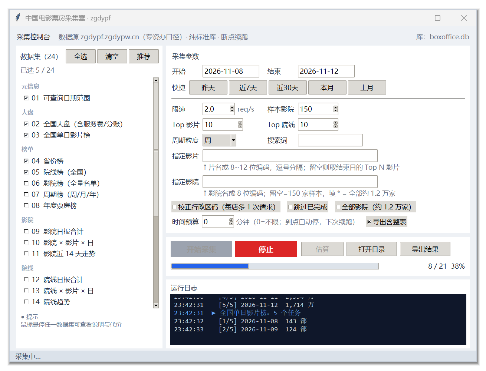

# 中国电影票房（专资办口径）采集复现

新版单片历史影院功能可通过桌面按钮或 `python pipeline.py movie-history --help` 打开。
操作步骤、审计字段和分批补采方法见 [单片历史影院使用说明](单片历史影院使用说明.md)。

对 zgdypf.zgdypw.cn 站内 JSON 接口做的一次**带契约验证**的采集复现。
目标不是把数据抓下来，而是先证明「这套方案在真实接口上成立到什么程度」，
再把可用的部分工程化。

## 下载

- 最新版：[Releases · latest](https://github.com/jym080621-dot/MovieData/releases/latest)
- 历史版本：`v1.0.0` → `v1.3.3`，每个版本都附源码包；`v1.0.0` 另附 Windows 免安装包（`MovieData_v1.0.0_win64.zip`）
- 源码运行：解压后 `python gui.py`（Python 3.10+，纯标准库，无需 `pip install`）

---

## 一、结论速览

| 项 | 结果 |
|---|---|
| 24 个数据集是否真实存在 | **是**，全部实测可用 |
| 五段叙述的参数/字段是否准确 | **否**，7 处需修正（见 `CONTRACT.md` 第一节） |
| 能否做「300~500 家 × 30 天」平衡面板 | **能，但必须选对窗口**：约 1/3 的日期影院维度整片缺失 |
| 金额单位 | 分（榜单整数）／万（顶部汇总）／**元或万漂移**（影院分片 Desc），三者并存 |
| 颗粒度上限 | 影院 × 影片 × 日；无影厅、无场次、无座位级 |
| 全量影院数 | 12,109 ~ 12,717 家（随日期波动） |

---

## 二、工程结构

```
.
├── zgdypf/                    采集与解析层（纯标准库）
│   ├── client.py              HTTP：全局限速、分级重试、原始响应落盘
│   ├── parse.py               单位解析（元/万/亿、分、占比），软失败
│   ├── ssr.py                 __INITIAL_STATE__ 抽取（字符串感知的括号配对）
│   ├── api.py                 24 个端点的函数封装，参数名按实测固定
│   ├── common.py              日期/金额行归一/完整性探针（CLI 与 UI 共用）
│   ├── datasets.py            24 个数据集注册表 + 执行引擎（UI 的底座）
│   ├── db.py                  SQLite schema + 通用 upsert + 断点台账
│   ├── sample.py              省份 × 规模三分位分层抽样
│   ├── qa.py                  8 项质量校验 + Markdown 报告
│   ├── export.py              导出 CSV / JSON（按影片、影院分目录）
│   ├── cinema_detail.py       影院详情页解析
│   ├── movie_history.py       单片历史影院：查询、补采、审计
│   └── history_roster.py      逐日影院名单
├── tests/                     单元测试
├── gui.py                     ★ Tkinter 图形界面（24 选 N、日期区间、进度、日志）
├── history_quick_gui.py       单片历史影院快捷窗口
├── pipeline.py                命令行主程序：init / day / verify / sample / box / movie / movie-history / qa / export
├── contract_test.py           32 条契约断言（改站点前先跑它）
├── build_release.py           打 release 包（exe + 源码 + 数据备份）
├── 启动采集器.bat              双击启动（探测 Python 3.10+，调 gui.py）
├── 启动单片全国历史.bat         双击打开「单片历史影院」
├── launch_source.bat          启动器（上面两个 .bat 都调它）
├── sample.csv                 锁定的样本名单
├── CONTRACT.md                接口实测契约（核心文档）
├── TABLES.md                  结果表（make_tables.py 生成）
├── QA_REPORT.md               质量报告（pipeline qa 生成）
├── 使用教程.md                 ★ 界面完整使用手册（每个选项、每个数字的含义）
├── 单片历史影院使用说明.md       单片历史影院的用法与审计字段
├── LICENSE                    MIT
└── ui_all.png, ui_running.png 界面截图
```

运行时自动生成（已在 `.gitignore` 中忽略，不提交）：

```
boxoffice.db   结果库
raw/           原始响应（按端点/日期/编码落盘，可回溯）
output/        导出结果
dist/ build/   打包产物
```

---

## 三、图形界面（推荐）

> 完整用法（每个选项、每个数字的含义）见 **[使用教程.md](使用教程.md)**。本节只讲入口。

双击 **`启动采集器.bat`**，或命令行 `python gui.py`。



| 区域 | 说明 |
|---|---|
| 左栏 | 24 个数据集分 8 组，自由勾选；悬停显示说明与代价；「推荐/全选/清空」 |
| 右栏上 | 起止日期 + 五个快捷预设（昨天/近7天/近30天/本月/上月） |
| 右栏中 | 限速、样本影院数、Top 影片/院线数、周期粒度、搜索词、是否校正行政区码、是否跳过已完成 |
| 按钮 | **开始采集**（后台线程）、**停止**（当前请求后退出）、**估算**（不发请求，预估请求数与耗时） |
| 底部 | 进度条 + `已处理/总数` + 实时日志（分级着色）+ 状态栏 |

要点：
- **采集在后台线程**，界面不卡；停止后已完成的日期不会重抓（台账保证）。
- 每个任务的成败都写进 `collect_ledger`，关掉程序再开、点「开始采集」会从缺口继续。
- 「估算」纯算术：勾选 `影院×影片×日` + 30 天 + 150 家 → 直接告诉你 4500 次请求、约 30 分钟。

### 命令行参数 ↔ 界面控件对照

**所有功能都能在界面里完成，不需要打开终端。** 命令行保留给批处理和自动化。

| 原来只能命令行的能力 | 现在在界面哪里 |
|---|---|
| `--start` / `--end` | 开始 / 结束 日期框 |
| `--rate` | 限速 req/s |
| `--n` | 样本影院 |
| `box --cinema "名称,编码"` | 指定影院 输入框 |
| `box --all-cinemas` | ☑ **全部影院（约 1.2 万家）** |
| `box --budget-min 240` | **时间预算 [240] 分钟** |
| `box --yes` | 请求数 > 2 万时自动弹确认框 |
| `movie --name / --code` | 指定影片 输入框 |
| `export --no-tables` | ☐ 导出含整表 |
| `export --out DIR` | 固定导出到 `output/` |
| `--skip-done` | ☑ 跳过已完成 |

三个新控件的含义：

- **全部影院**：勾上后「指定影院」自动置灰并清空，任务量从 150 家变成约 1.2 万家
  （30 天 ≈ 37 万次请求 ≈ 75 小时）。估算按钮会立刻体现这个量级。
- **时间预算**：单位分钟，`0` 表示不限。到点后不再发起新请求，
  已完成的任务全部落库，日志会提示「下次从缺口继续」。
- **导出含整表**：勾上会导出 `tables/`（影院×日等大表，约 80 MB）；取消则只导影片/影院文件夹，秒级完成。

### 怎么查某一部指定电影

三种入口，结果完全一样：

**① 图形界面**（最省事）
1. 左侧勾选 **`17 影片详情页（逐日序列）`**（想顺便建索引就再勾 `16 影片搜索`）；
2. 在 **「指定影片」** 里填片名或编码，多部用逗号：`哪吒之魔童闹海, 00101110026`；
3. 点「开始采集」。

留空时才会退化成「取结束日 Top N 影片」——填了名字就一定是你要的那部。

**② 命令行**
```bash
python pipeline.py movie --name "哪吒之魔童闹海"     # 自动反查 movieCode
python pipeline.py movie --code 00100072025          # 已知编码可跳过搜索
```

**③ 直接查网页**
`https://zgdypf.zgdypw.cn/movie/detail/<movieCode>`，页面里的逐日表就是数据源；
也可以在首页搜索框输入片名，点进去看地址栏末段拿编码。

**入库后这样取数**（`fact_movie_day`，金额单位：分）：

```sql
SELECT show_date, release_days AS 上映第N天,
       sales_fen/1e6 AS 单日万元, sales_count AS 人次,
       session_count AS 场次, sales_rate, session_rate, seat_rate
FROM fact_movie_day
WHERE movie_code = '00100072025'
ORDER BY release_days;
```

> 注意区分三种「某某片的数据」：
> - **全国单日** → `fact_movie_day`（上面这条）
> - **某影院该片** → `fact_cinema_movie`（需先采「影院×影片×日」，按样本影院）
> - **某城市该片** → `fact_city`（需勾「单片城市分布」）

### 怎么采某一家指定影院

**① 图形界面**
1. 勾选 **`10 影院 × 影片 × 日`**（要日报/趋势再加 `09` / `11`）；
2. 在 **「指定影院」** 填影院名或 8 位编码，多家用逗号：`上海影城, 33019193`；
3. 点「开始采集」。

留空 = 跑 150 家分层样本；填了 = **只跑这几家**，连「估算」也按实际家数算
（2 家 × 30 天 = 60 次请求，而不是 4500 次）。

**② 命令行**
```bash
python pipeline.py box --cinema "上海影城,33019193" --start 2026-04-01 --end 2026-04-30
```

**③ 只要近 14 天趋势**：勾 `11 影院近 14 天走势` + 指定影院即可，每家 1 次请求。

> **重名警告**：影院名全国重复极多（「英嘉」有 5 家：北京海淀、云南文山、重庆金源、广州番禺、昆明金源）。
> 输入短名时脚本取第一条并在日志里打印候选，**务必扫一眼**；拿不准就直接填 8 位编码。
> 编码可用 `10 影院搜索` 数据集查，或从网页 `/cinema/detail/<编码>` 地址栏取。

---

## 四、快速开始（命令行）

```bash
# 0. 环境：Python 3.10+，纯标准库，无需 pip install
python contract_test.py                 # 先验契约，32 条断言

# 1. 探测某段日期的影院维度可用性
python pipeline.py verify --start 2026-04-01 --end 2026-04-30

# 2. 逐日拉大盘 / 省份 / 院线 / 全量影院榜
python pipeline.py day --start 2026-04-01 --end 2026-04-30

# 3. 分层抽样（150 家；--n 300 即可放大）
python pipeline.py sample --date 2026-04-30 --n 150

# 4. 样本 × 日 的影院分片（断点续跑，可加 --budget-min 分段跑）
python pipeline.py --rate 2.0 box --start 2026-04-01 --end 2026-04-30

# 5. 质量校验
python pipeline.py qa --md QA_REPORT.md

# 6. 影片维度（SSR）回归：应精确复现 D1-D4
python pipeline.py movie --code 00100072025
```

---

## 五、输出：按影片分目录

点界面「**导出结果**」，或命令行：

```bash
python pipeline.py export              # 影片 + 整表
python pipeline.py export --no-tables  # 只导影片（秒级）
python -m zgdypf.export --movie 00100072025   # 只导一部
```

目录结构：

```
output/
├── README.txt                        口径说明 + 字段字典（自动生成）
├── index.csv                         影片索引：编码/片名/天数/累计/峰值/目录
├── cinemas_index.csv                 影院索引：编码/名称/天数/片目行数/票房合计
├── movies/
│   └── 00100072025_哪吒之魔童闹海/
│       ├── daily.csv                 逐日票房（180 行）
│       └── summary.json              汇总 + 地区 Top + 院线 Top
├── cinemas/
│   └── 31081501_上海市上海影城/
│       ├── daily.csv                 逐日票房/人次/场次/网售占比
│       ├── movies.csv                该店逐日片目明细
│       └── summary.json              汇总
└── tables/
    ├── national.csv                  全国大盘（含服务费 + 分账）
    ├── province.csv                  省份榜
    ├── chain.csv                     院线榜
    ├── movie_national_day.csv        影片 × 日（全国）
    ├── cinema_day_2026-04.csv        影院 × 日（按月分文件）
    ├── cinema_movie_2026-04.csv      影院 × 影片 × 日（样本影院）
    └── city.csv                      单片城市分布
```

**格式约定**（详细字段见 `output/README.txt`）：

| 约定 | 做法 |
|---|---|
| 编码 | CSV 用 **UTF-8 with BOM**，Excel 双击不乱码；JSON 用 UTF-8 无 BOM |
| 金额 | 同时给「元」和「万元」两列，保留 2 位小数，不用二次换算 |
| 比例 | 写成百分数 `12.34%`，不是小数 `0.1234` |
| 缺失 | 写空字符串，不写 `NULL` / `nan` / `-` |
| 排序 | 影片逐日按「上映第 N 天」升序；榜单按票房降序 |
| 文件命名 | `movies/<影片编码>_<片名>/`，编码在前保证可排序、可去重 |

`tables/cinema_day_*.csv` 有两列专门用于质检：

- **金额来源**：`精确`（分片接口求和）或 `榜单解析`（字符串截断）
- **是否截断**：`是` 表示该行金额被向下截到 100 元，做精确分析时应优先用分片来源

---

## 六、相对原始方案的修正

原方案（五段聊天记录）思路可用，但有 7 处会在**不报错的前提下算错数**，已全部修正：

1. **影院榜没有 `sales` 整数字段** → 金额从 `salesDesc` 解析，并标记 `sales_lossy`；
   影院级精确值只来自分片接口的求和。
2. **`salesDesc` 单位漂移**（`"9453"` 是元，`"5.65万"` 是万）→ 裸数字统一按「元」，
   字段名含 `InWan` 的按「万」，解析结果同时保留原始串。
3. **`geoType=1` 是「区域」不是「全国」** → 全国固定 `geoCode=0&geoType=0`，
   并加断言：`1/1` 的合计必须显著小于 `0/0`。
4. **204 / `"--"` 两种空值** → `getCinemaBoxData` 看 204，`getCinemaSumData` 看 `value=="--"`，
   统一记 `empty` 且不重试。
5. **`getSingleDayData` 参数无效** → 不再按日期调用，仅作历史纪录。
6. **404/400 被无谓重试** → 400/404 立即抛 `HardError`，仅 5xx/超时退避重试 1s/4s/16s。
7. **小 `limit` 的 `hasMore` 假阳性** → 完整性探测改用 `limit=10&offset=11000`。

新增的两道闸门（原方案没有，但缺了必错）：

- **按日开闸**：`getCinemaList` 返回值若不足 11000 家，视为该日影院维度塌缩，整日跳过；
- **可疑日回滚**：某日 204 率 > 50% 时撤销该日全部 `empty` 台账，待重抓。

---

## 七、存储

金额统一存「分」（`*_fen`），展示层再除 100。核心表：

| 表 | 主键 | 说明 |
|---|---|---|
| `dim_cinema` | `cinema_code` | 省份/城市由名称解析，抽样后再用 `searchCinema.cityCode` 精确校正 |
| `fact_cinema_day` | `(cinema_code, date)` | 两个来源：`ranklist`（全量、损失精度）与 `box`（样本、精确） |
| `fact_cinema_movie` | `(cinema_code, date, movie_code)` | 影院 × 影片 × 日 |
| `fact_province` / `fact_chain` | `(date, code)` | 榜单 |
| `fact_national` | `date` | 双口径 + 服务费占比 |
| `fact_movie_day` | `(movie_code, show_date)` | SSR 逐日序列 |
| `collect_ledger` | `(job, key)` | 断点台账，`ok/empty/error` |
| `date_status` | `date` | 逐日可用性（`full/thin/error`） |

---

## 八、本次复现产物（2026-11-13 实跑）

| 项 | 数值 |
|---|---|
| 契约断言 | **32 / 32 通过**（15.6 s，22 次请求，0 重试） |
| 面板窗口 | 2026-04-01 ~ 04-30（30 天，经探测全部完整） |
| 样本 | 150 家，覆盖 31 省，规模三分位 T1/T2/T3 = 35/54/61 |
| 影院 × 日（全量榜） | 615,090 行 / 50 天（含额外探测窗口） |
| 影院 × 影片 × 日（样本） | **47,761 行 / 30 天** |
| 采集请求 | 4,500 次（4,493 ok + 7 empty + 0 error），52.3 分钟，≈1.4 req/s |
| 空值率 | 0.16%（7 家影院个别日期确实无排片） |
| 影片回归 | 哪吒2 D1–D4 与基准逐分吻合（误差 < 0.001%） |
| 数据库 | 111 MB（SQLite） |
| 原始响应 | 5,425 个文件 / 163 MB |

---

## 九、合规

只访问公开页面同款接口；全局限速 ≤ 2.5 req/s；不做全站镜像、不转售；
`raw/` 仅作回溯用途。数据来源：中国电影票房（专资办口径）。


---

## 十、打包与分发

```bash
python build_release.py --build --data
```

产出都在 `dist/`：

| 产物 | 体积 | 内容 |
|---|---:|---|
| `电影票房采集器_v1.0_win64/` | — | 可执行目录（exe + 使用教程 + 说明 + 截图） |
| `电影票房采集器_v1.0_win64.zip` | 14.1 MB | 上面那个目录的压缩包，双击 exe 即用，**无需 Python** |
| `MovieData_源码_<日期>.zip` | 0.4 MB | 全部源码 + 文档 + 启动脚本（0.4 MB） |
| `MovieData_数据备份_<日期>.zip` | 30.8 MB | `boxoffice.db`（111.7 MB 压缩到 30.8）+ 样本名单 |

说明：

- exe 用 PyInstaller `--onefile --windowed` 打的，单文件 14 MB，启动约 2 秒。
- **打包后路径的关键改动**：onefile 模式下 `__file__` 指向临时解包目录，
  若按它取路径，数据库和 raw 会写进 `%TEMP%\_MEIxxxx`，退出即丢。
  因此 `zgdypf.app_root()` 在 `sys.frozen` 为真时改用 **exe 所在目录**。
- 数据备份**不含** `raw/`（163 MB 原始响应，可重采）与 `output/`（86 MB，可从库 8 秒重导）。
- 重建一次约 8 秒；`build/` 是 PyInstaller 中间目录，可随时删。
