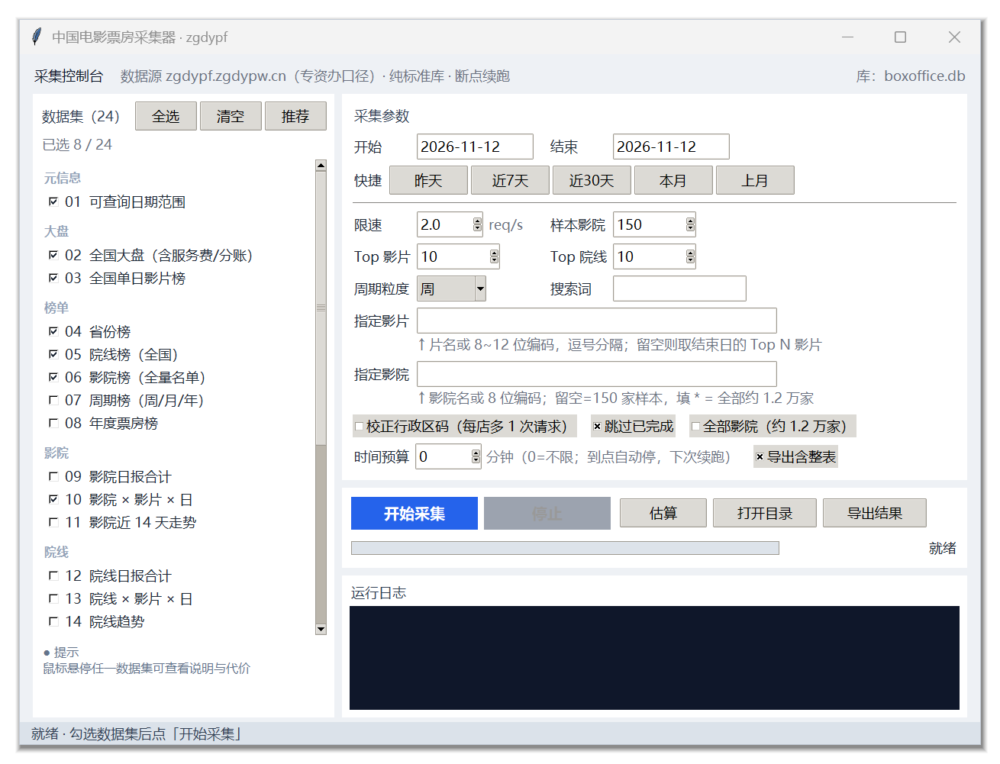

# 中国电影票房采集器 · 使用教程

> 适用版本：`gui.py` + `zgdypf/`（2026-11 版）
> 数据源：`zgdypf.zgdypw.cn`（中国电影票房，专资办口径，含服务费）
> 运行环境：Windows + Python 3.7 以上，**纯标准库，无需安装任何依赖**

---

## 目录

1. [它是什么](#一它是什么)
2. [启动与界面总览](#二启动与界面总览)
3. [左栏：24 个数据集](#三左栏24-个数据集)
4. [右栏：15 项参数](#四右栏15-项参数)
5. [五个按钮](#五五个按钮)
6. [进度、日志与状态词](#六进度日志与状态词)
7. [六种典型用法](#七六种典型用法)
8. [输出文件说明](#八输出文件说明)
9. [故障排查](#九故障排查)
10. [单位、口径与已知限制](#十单位口径与已知限制)
11. [跑完自查清单](#十一跑完自查清单)
12. [附录：数据集与数据库表对照](#附录数据集与数据库表对照)

---

## 一、它是什么

一个把「中国电影票房」网站上 24 类公开数据抓下来、存进本地 SQLite、再导出成 Excel 可读表格的小工具。

**能拿到**：

| 维度 | 内容 | 粒度 |
|---|---|---|
| 大盘 | 全国单日票房，含服务费与分账两套口径 | 日 |
| 榜单 | 省份 / 院线 / 影院 / 影片 的当日排行 | 日 |
| 影院 | 每家影院每天卖了多少、多少人、多少场 | 影院 × 日 |
| 影院片目 | 每家影院每天每部片卖了多少 | 影院 × 影片 × 日 |
| 影片 | 每部片全国逐日票房、排片、上座率 | 影片 × 日 |
| 纪录 | 历史单日/单周/单月票房 Top20 | 全历史 |

**拿不到**（站点本身没有）：

- 影厅级、场次级、座位级数据
- 单个场次的上座率（只有影院级日均）
- 影院属于哪条院线（接口未提供映射）

**口径提醒**：全站为专资办口径、默认**含服务费**，与猫眼专业版、灯塔的数字会差几百万到千万级。写报告时要注明来源口径。

---

## 二、启动与界面总览

### 2.1 三种启动方式

| 方式 | 操作 | 说明 |
|---|---|---|
| 双击 | 运行 `启动采集器.bat` | 用 `pythonw` 启动，无黑色控制台窗口（推荐） |
| 命令行 | `python gui.py` | 保留控制台，方便看报错 |
| 自检 | `python gui.py --selftest` | 建界面 → 跑 2 个数据集 → 自动退出，用于验证环境 |

首次启动会自动在程序目录建 `boxoffice.db`，不需要任何初始化操作。

### 2.2 界面分五个区域



| 区域 | 位置 | 作用 |
|---|---|---|
| **数据集** | 左栏 | 24 项复选，决定这一轮抓什么 |
| **参数** | 右上 | 日期、限速、规模、指定对象等 15 项 |
| **操作** | 右中 | 开始 / 停止 / 估算 / 打开目录 / 导出 |
| **日志** | 右下 | 实时输出，每个任务一行 |
| **状态栏** | 最底部 | 当前状态或完成后的汇总 |

窗口可以拉大；左侧数据集列表可滚动，鼠标悬停任一项会显示该数据集的说明与代价。

---

## 三、左栏：24 个数据集

### 3.1 一行怎么读

```
☑ 10  影院 × 影片 × 日
│  │   └── 名称
│  └────── 编号（按分组顺序固定编号，教程里就用这个号）
└───────── 复选框：勾上才采
```

- 列表上方显示 **`已选 N / 24`**，实时更新。
- **鼠标悬停**任一数据集，左上角会显示一句话说明。
- 三个小按钮：**全选**（24 个全勾）、**清空**（全不勾）、**推荐**（恢复 8 个默认项）。

### 3.2 分组

| 组 | 编号 | 一句话 |
|---|---|---|
| 元信息 | 01 | 站点支持哪些日期 |
| 大盘 | 02–03 | 全国每天卖了多少、有哪些片 |
| 榜单 | 04–08 | 省份/院线/影院/影片/周期的排行 |
| 影院 | 09–11 | 单店维度：日报、片目、走势 |
| 院线 | 12–15 | 院线维度：日报、片目、趋势、昨日对比 |
| 影片 | 16–17 | 单片维度：城市分布、逐日曲线 |
| 搜索 | 18–19 | 名称 → 编码的反查 |
| 纪录 | 20–24 | 历史 Top20 榜单（参数无效） |

### 3.3 逐项说明

#### 元信息

**01 可查询日期范围**
调 `/getDateRange`，返回 `2017-01-01 ~ 今天`。
**用途**：确认你要的日期站点支持。成本 1 次请求，几乎必勾。

#### 大盘

**02 全国大盘（含服务费/分账）** ★默认
每天两次请求，分别取含服务费与不含服务费两个口径，并算出差额（服务费占比）。
**用途**：任何分析的基准分母。成本 = 天数。

**03 全国单日影片榜** ★默认
当天所有影片的票房、排片占比、票房占比、上座率、网售占比。
**用途**：看当天有哪些片在放、各占多少。成本 = 天数。

#### 榜单

**04 省份榜** ★默认
31 个省的当日票房、人次、场次、场均、单座产出、网售占比。
成本 = 天数。

**05 院线榜（全国）** ★默认
约 50 家院线的当日数据。
> 注意：必须传 `geoCode=0&geoType=0` 才是全国；传 `1/1` 会变成"华北"（脚本已固定为 0/0）。
成本 = 天数。

**06 影院榜（全量名单）** ★默认
一天一次请求拿回**全部约 1.2 万家影院**的当日数据，同时建立/更新影院维表（省份、城市）。
> 带完整性闸门：不足 1.1 万家视为站点当天数据塌缩，会整天跳过而不是写入残缺数据。
成本 = 天数。

**07 周期榜（周/月/年）**
按"周期起始日"取该周期内的影片排行。
> 必须传周期起始日（周一 / 每月 1 号 / 每年 1 月 1 日），传中间日期会静默返回空。
成本 = 周期数（由「周期粒度」决定）。

**08 年度票房榜**
每一年一个请求，取该年影片排行 Top300。
成本 = 年数。

#### 影院

**09 影院日报合计**
逐日逐店调 `/getCinemaSumData`：当日票房、在映片数、新片数、场次。
**注意**：这个接口对日票房不足 1000 元的店返回 `"<0.1"`，脚本会存成"上界 1000 元"并标记，不当空值丢弃。
成本 = 天数 × 影院数。

**10 影院 × 影片 × 日** ★默认
核心交叉表：每家影院每天的每部片的票房、占本店比、排片占比、本店累计。
**这是最贵的一项**。成本 = 天数 × 影院数。
不指定影院时用 150 家样本；指定影院后只跑指定的几家。

**11 影院近 14 天走势**
每家影院一次请求，返回近期逐日序列（票房、人次、场次、场均、单座产出、网售占比）。
> 返回的是"最近 14 条有数据的记录"，不一定是 14 个连续日历日。
成本 = 影院数。

#### 院线

**12 院线日报合计** — 逐日逐院线的票房/在映片数/场次。成本 = 天数 × Top院线数。
**13 院线 × 影片 × 日** — 院线维度的片目明细。成本 = 天数 × Top院线数。
**14 院线趋势** — 每家院线近 14 天序列。成本 = Top院线数。
**15 院线昨日对比** — 含环比、排名变化。成本 = Top院线数。

> 院线相关的四项都受「Top 院线」参数控制，默认只跑前 10 家（全国共约 50 家）。

#### 影片

**16 单片城市分布**
逐日取当天 Top N 影片的城市票房榜（约 51 个城市）。
**用途**：看某部片在哪些城市卖得好。成本 = 天数 × Top影片数。

**17 影片详情页（逐日序列）** ★默认
一部片 **1 次请求**拿到全历史逐日曲线（哪吒2 是 180 天），外加累计/首周/首日三个汇总和地区/院线 Top。
> 影片页是服务端渲染，没有 JSON 接口，脚本从 HTML 里抠 `__INITIAL_STATE__`。

不指定影片时取"结束日 Top N 影片"；在「指定影片」里填了名字就只抓那几部。成本 = 影片数。

#### 搜索

**18 影院搜索（名称→编码）** — 输入关键词，返回匹配影院的编码、行政区、影厅数、座位数。成本 1 次。
**19 影片搜索（名称→编码）** — 输入片名，返回影片编码与上映信息。成本 1 次。

> 这两个适合"先查编码、再填到指定框里"。结果会存进库（`fact_doc`），可在日志里直接看到前几条。

#### 纪录

**20–24 历史纪录**：五个接口结构相同，**完全忽略参数**，传什么日期都返回同一份全历史 Top20。

| # | 数据集 | 返回内容 |
|---:|---|---|
| 20 | 影片单日票房纪录 | 全历史「单片单日」票房 Top20 |
| 21 | 影片首日票房纪录 | 全历史「影片首映日」票房 Top20 |
| 22 | 大盘单日纪录 | 全历史单日大盘 Top20 |
| 23 | 大盘单周纪录 | 全历史单周大盘 Top20 |
| 24 | 大盘单月纪录 | 全历史单月大盘 Top20 |

**用途**：做历史纵览、给当前数据找基准线。成本各 1 次请求，勾上也无妨。

### 3.4 请求量怎么算

| 粒度 | 公式 | 例子 |
|---|---|---|
| 按日 | 天数 | 30 天 = 30 次 |
| 单次 | 1 | — |
| 按年 | 年数 | 2024–2026 = 3 次 |
| 按周期 | 周期数 | 30 天按周 = 5 次 |
| 按影院 | 影院数 | 150 家 = 150 次 |
| 按院线 | Top院线数 | 10 家 = 10 次 |
| 按影片 | 影片数 | 10 部 = 10 次 |
| 日 × 影院 | 天数 × 影院数 | **30 × 150 = 4,500 次** |
| 日 × 院线 | 天数 × Top院线数 | 30 × 10 = 300 次 |
| 日 × 影片 | 天数 × Top影片数 | 30 × 10 = 300 次 |

点「估算」按钮会直接把总数和预计耗时算给你，**不发请求**。

---

## 四、右栏：15 项参数

### 4.1 开始 / 结束日期

| 项 | 值 |
|---|---|
| 格式 | `YYYY-MM-DD`，如 `2026-04-01` |
| 默认 | 都是"昨天" |
| 校验 | 格式错误会弹窗；结束早于开始会自动对调 |

**怎么选**：只采「昨天及以前」。当天数据全天滚动（每 5 秒刷新一次），白天抓到的数字晚上就变了。

### 4.2 快捷按钮

| 按钮 | 作用 |
|---|---|
| 昨天 | 起止都设为昨天 |
| 近7天 | 结束=昨天，开始=今天−7 |
| 近30天 | 结束=昨天，开始=今天−30 |
| 本月 | 开始=本月 1 号，结束=昨天 |
| 上月 | 开始=上月 1 号，结束=上月最后一天 |

### 4.3 限速

| 项 | 值 |
|---|---|
| 范围 | 0.5 – 5.0，步长 0.5 |
| 默认 | 2.0（次/秒） |

**含义**：每秒最多发起几次请求。数值越大越快，也越容易被站点当成异常流量。

**实测**：设定 2.0 时，实际吞吐约 **1.2 次/秒**——因为每次请求还有 TLS 握手、解析、写盘的开销。所以「估算」按 `设定值 × 0.6` 折算，比较接近真实耗时。

**怎么选**：
- 日常增量：2.0
- 大批量过夜：2.0 即可，别超过 3.0
- 调试：3.0–5.0 也安全，但别长期跑

### 4.4 样本影院

| 项 | 值 |
|---|---|
| 范围 | 10 – 500，步长 10 |
| 默认 | 150 |

**含义**：当「指定影院」留空时，用多少家影院做分层样本（按省份 × 规模三分位抽取）。

**影响**：只影响 09 / 10 / 11 三个影院类数据集的请求量。
150 家 × 30 天 = 4,500 次；300 家 × 30 天 = 9,000 次。

**怎么选**：

| 目的 | 建议 |
|---|---|
| 看一眼结构 | 50 |
| 常规面板 | 150（约 1 小时/月） |
| 论文级面板 | 300–500（约 2.5 小时/月） |

> 样本一旦抽出就**固定**在 `dim_cinema.sample=1`，之后不会自动换，保证面板平衡。想重抽就再点一次「开始采集」（会重新抽并覆盖）。

### 4.5 Top 影片

| 项 | 值 |
|---|---|
| 范围 | 1 – 50 |
| 默认 | 10 |

**含义**：影片类数据集（16 城市分布、17 详情页）默认取"结束日票房前 N 名"。

**影响**：16 的请求量 = 天数 × N；17 的请求量 = N（或你指定的影片数）。

**怎么选**：只是看头部影片 → 10；要做全市场影片分析 → 30–50。

### 4.6 Top 院线

| 项 | 值 |
|---|---|
| 范围 | 1 – 50 |
| 默认 | 10 |

**含义**：院线类数据集（12–15）只跑票房前 N 家院线。全国共约 50 家。

**影响**：12/13 的请求量 = 天数 × N；14/15 = N。

### 4.7 周期粒度

| 项 | 值 |
|---|---|
| 选项 | 周 / 月 / 年 |
| 默认 | 周 |

**含义**：07「周期榜」按什么粒度展开。选"周"会把日期区间覆盖到的每个周一都跑一遍；选"月"取每月 1 号；选"年"取每年 1 月 1 日。

**注意**：这个参数只影响 07，不影响其他数据集。

### 4.8 搜索词

| 项 | 值 |
|---|---|
| 默认 | 空 |
| 用途 | 18 影院搜索 / 19 影片搜索的关键词 |

**含义**：填了就用它搜；留空时影院搜默认用「英嘉」、影片搜默认用「哪吒」（只是演示关键词，建议自己填）。

**示例**：填 `万达` 会返回全国所有带"万达"的影院。

### 4.9 指定影片

| 项 | 值 |
|---|---|
| 格式 | 片名 或 8~12 位编码，多个用逗号 |
| 默认 | 空 = 取结束日 Top N |
| 示例 | `哪吒之魔童闹海, 00101110026` |

**作用**：勾了 17「影片详情页」时，只抓这里列出的片，而不是 Top N。

**行为**：
- 纯数字 → 直接当 `movieCode`
- 中文名 → 调 `/searchMovie` 反查，精确同名优先，否则取第一条
- 日志会打印 `「关键词」→ 实际片名（编码）`，**跑完扫一眼**，别抓错片

**成本**：每部片 1 次请求（返回全历史，180 天也只要 1 次）。

### 4.10 指定影院

| 项 | 值 |
|---|---|
| 格式 | 影院名 或 8 位编码，多个用逗号；`*` 表示全部 |
| 默认 | 空 = 用 150 家分层样本 |
| 示例 | `上海影城, 33019193` |

**作用**：勾了 09 / 10 / 11 时，只跑这里列出的影院。

**行为**：
- 8 位纯数字 → 直接当编码
- 中文名 → 调 `/searchCinema` 反查。**影院重名极多**（"英嘉"全国 5 家），命中多家时取第一条并打印全部候选
- `*` 或勾选「全部影院」→ 跑库里已知的全部影院（约 1.2 万家）

**成本对比**（30 天）：

| 填法 | 请求量 | 耗时 |
|---|---:|---:|
| 留空（150 家样本） | 4,500 | 约 1 小时 |
| 一家店 | 30 | 几十秒 |
| `*` 全部 | 377,640 | 约 75 小时 |

**怎么查编码**：勾 18「影院搜索」，填关键词，看日志或 `output/` 里的搜索结果；或从网页 `/cinema/detail/<编码>` 地址栏取。

### 4.11 校正行政区码（复选框）

| 项 | 值 |
|---|---|
| 默认 | 不勾 |

**含义**：抽样时对每家影院额外调一次 `/searchCinema`，用返回的 `cityCode` 反推省份，替代"从影院名解析"的粗略做法。

**代价**：多 N 次请求（150 家 = 多 150 次），抽样阶段慢 2 分钟。

**建议**：做省级分析时勾上；只做全国汇总可以不勾。

### 4.12 跳过已完成（复选框）

| 项 | 值 |
|---|---|
| 默认 | 勾选 |

**含义**：每个任务完成后写一条台账 `(数据集, 任务键)`。再次运行时跳过已完成的。

**不勾的后果**：所有任务重抓一遍，覆盖写（数据不会错，只是白花时间）。

**建议**：一直勾着。中断、关机、跑一半想换参数，都靠它续跑。

### 4.13 全部影院（复选框）

| 项 | 值 |
|---|---|
| 默认 | 不勾 |

**含义**：勾上后「指定影院」输入框会自动置灰并清空，任务量变成**库里已知的全部影院（约 1.2 万家）**。

**代价**：30 天 ≈ 37.7 万次请求 ≈ 75 小时 ≈ 750 MB 原始数据 + 400 万行入库。

**建议**：只在确实需要"每一家每一部片"时才用。配合「时间预算」分批跑，每晚上跑 4 小时，一周跑完。

### 4.14 时间预算

| 项 | 值 |
|---|---|
| 范围 | 0 – 1440，单位分钟 |
| 默认 | 0 = 不限 |

**含义**：本次运行最多花多少分钟。到点后不再发起新请求（当前请求会做完），已完成的全部落库，日志提示"下次从缺口继续"。

**用法**：设 240 = 跑 4 小时自动停。适合过夜跑大盘，早上看结果，晚上接着跑。

**注意**：这是"优雅停止"，不是杀进程。台账保证不重不漏。

### 4.15 导出含整表（复选框）

| 项 | 值 |
|---|---|
| 默认 | 勾选 |

**含义**：点「导出结果」时，是否连 `tables/` 里的大表（影院×日、影院×影片×日）一起导出。

| 状态 | 内容 | 耗时 | 体积 |
|---|---|---|---|
| 勾选 | 影片 + 影院 + 全部整表 | 5–10 秒 | 约 80 MB |
| 不勾 | 只有影片 / 影院文件夹 | 1–2 秒 | 几 MB |

### 4.16 参数速查

| 参数 | 默认 | 范围 | 影响的数据集 |
|---|---|---|---|
| 开始/结束 | 昨天 | 2017-01-01 ~ 昨天 | 全部按日的 |
| 限速 | 2.0 | 0.5 – 5.0 | 全部（只影响速度） |
| 样本影院 | 150 | 10 – 500 | 09 / 10 / 11 |
| Top 影片 | 10 | 1 – 50 | 16 / 17 |
| Top 院线 | 10 | 1 – 50 | 12 / 13 / 14 / 15 |
| 周期粒度 | 周 | 周 / 月 / 年 | 07 |
| 搜索词 | 空 | 任意文本 | 18 / 19 |
| 指定影片 | 空 | 片名或编码 | 17 |
| 指定影院 | 空 | 名称/编码/`*` | 09 / 10 / 11 |
| 校正行政区码 | 关 | 开/关 | 抽样阶段 |
| 跳过已完成 | 开 | 开/关 | 全部 |
| 全部影院 | 关 | 开/关 | 09 / 10 / 11 |
| 时间预算 | 0 | 0 – 1440 分钟 | 全部（控制何时停） |
| 导出含整表 | 开 | 开/关 | 导出 |

---

## 五、五个按钮

### 估算
- **不发任何请求**，纯算术。
- 输出：总请求数、预计耗时（按 `限速 × 0.6` 折算）、每个数据集的分解。
- 用途：开跑前确认量级。看到 `377,640 次` 就该知道要分批。

### 开始采集
- 在**后台线程**运行，界面不卡。
- 启动前会校验参数；请求数超过 2 万会弹二次确认框。
- 运行中按钮变灰，可随时点「停止」。

### 停止
- **优雅停止**：当前请求做完、写库后退出，不会留半条数据。
- 已完成的日期不会重抓，下次从缺口继续。

### 打开目录
- 直接打开程序所在文件夹（`D:\MovieData`），看数据库、raw 目录和输出。

### 导出结果
- 后台执行导出，完成后提示「N 部影片 · M 家影院 · X MB」。
- 采集进行中会被禁用，避免读到写一半的数据。

---

## 六、进度、日志与状态词

### 6.1 进度区

```
[██████████░░░░░░░░]   1,234 / 4,500  27%                 就绪
```
- 进度条：已完成任务 / 总任务
- 右侧文字：完成百分比
- 最右：当前状态（就绪 / 启动中… / 完成 · 成功 N）

### 6.2 日志格式

```
22:19:52  ▶ 全国大盘（含服务费/分账）：30 个任务
22:19:53    [1/30] 2026-04-01  4,172 万
22:19:54    [2/30] 2026-04-02  2,260 万
```
`时间 + 内容`。数据集开始时有 `▶`，每个任务一行显示 `[进度] 标识 结果`。

### 6.3 状态词表

| 日志里的词 | 含义 | 要不要管 |
|---|---|---|
| `4,172 万` / `133 部` / `12,588 家` | 成功，附带关键数字 | 不用 |
| `无数据` | 该影院该日无排片（HTTP 204 或 `--`） | 正常，占比通常 < 1% |
| `⚠ 仅 25 家，跳过` | 站点当天影院数据塌缩，整天跳过 | 不用管，换日期重跑即可 |
| `参数错误` | HTTP 400，参数写错（通常是站点改版） | 要管，跑一次契约测试 |
| `失败` | 重试 3 次仍失败（超时/5xx） | 少量正常，多了查网络 |
| `异常:KeyError` 等 | 解析出错，站点结构可能变了 | 要管 |
| `⏸ 时间预算 X 分钟用尽` | 到点自动停 | 正常，再点开始续跑 |
| `⏹ 已停止` | 你点了停止 | 正常 |

### 6.4 结束汇总

```
完成 · 成功 4,343 · 空 7 · 失败 0 · 跳过 150
网络 4,500 次 · 重试 0 · 用时 52.3 分钟
```

- **成功**：拿到数据并入库
- **空**：接口明确返回"无数据"
- **失败**：重试后仍失败（会留在台账里，下次重抓）
- **跳过**：上次已完成，这次按「跳过已完成」略过

---

## 七、六种典型用法

### 用法 1：每天补增量（最常用，10 分钟）

1. 点「昨天」
2. 保持默认勾选：01 日期范围、02 全国大盘、03 影片榜、04 省份、05 院线、06 影院榜
3. **取消** 10 影院×影片×日 和 17 影片详情页（日常增量不需要片目级）
4. 点「估算」→ 应显示 **6 次请求**
5. 点「开始采集」

> 想连片目一起补：保留 10，成本变成 150 次。挂到 Windows 计划任务里每天 2:30 跑即可。

### 用法 2：查一部指定电影

1. 勾 **17 影片详情页**
2. 「指定影片」填 `哪吒之魔童闹海`（或多部：`抓娃娃, 00101110026`）
3. 点「开始采集」

结果：1 次请求拿到全历史逐日曲线（180 天）。日志会显示 `哪吒之魔童闹海 180 天`。

### 用法 3：查一家指定影院

1. 勾 **10 影院 × 影片 × 日**（要日报/趋势再加 09 / 11）
2. 「指定影院」填 `上海影城` 或 `33019193`
3. 点「开始采集」

`估算` 会立刻从 4,500 变成 30（一家店 × 30 天）。

### 用法 4：建一个月的平衡面板

1. 日期设为整月（如 2026-04-01 ~ 2026-04-30）
2. 勾 02、04、05、06、10
3. 样本影院设 `150`
4. 点「估算」→ 应显示约 4,530 次、约 63 分钟
5. 「时间预算」可设 0（不限）或 70
6. 点「开始采集」

> 若中途塌缩，日志会出现 `⚠ 仅 25 家，跳过`，那天不会写入残缺数据；事后单独补那天即可。

### 用法 5：全量片目（3 天的大活）

1. 勾 **10 影院 × 影片 × 日**
2. 勾 ☑ **全部影院**
3. 「时间预算」设 `240`（每晚 4 小时）
4. 点「开始采集」→ 弹窗确认 37 万次请求 → 是
5. 第二天再点一次「开始采集」，自动从缺口继续

> 建议先只跑 3 天验证数据质量，再放开全月。

### 用法 6：只导出，不采集

1. 取消所有勾选（点「清空」）
2. 点「导出结果」
3. 完成后点「打开目录」→ `output/`

想看导出是否包含整表，看勾选框「导出含整表」。

---

## 八、输出文件说明

点「导出结果」后，程序目录下会生成 `output/`：

```
output/
├── README.txt                口径说明 + 字段字典（自动生成，建议先看这个）
├── index.csv                 影片索引（一部一行）
├── cinemas_index.csv         影院索引（一家一行）
├── movies/
│   └── 00100072025_哪吒之魔童闹海/
│       ├── daily.csv         逐日票房
│       └── summary.json      汇总 + 地区 Top + 院线 Top
├── cinemas/
│   └── 31081501_上海市上海影城/
│       ├── daily.csv         逐日票房/人次/场次/网售占比
│       ├── movies.csv        该店逐日片目明细
│       └── summary.json      汇总
└── tables/
    ├── national.csv          全国大盘（两套口径）
    ├── province.csv          省份榜
    ├── chain.csv             院线榜
    ├── movie_national_day.csv 影片 × 日
    ├── cinema_day_YYYY-MM.csv 影院 × 日（按月）
    ├── cinema_movie_YYYY-MM.csv 影院 × 影片 × 日（按月）
    └── city.csv              单片城市分布
```

### 格式约定

| 项 | 规则 |
|---|---|
| 编码 | CSV 为 **UTF-8 with BOM**，Excel 双击不乱码 |
| 金额 | 同时给「元」和「万元」，2 位小数 |
| 比例 | 百分数 `12.34%`，不是小数 |
| 缺失 | 空字符串，不写 `NULL` |
| 排序 | 影片按上映天数升序，榜单按票房降序 |

### 关键列说明

**movies/*/daily.csv**

| 列 | 含义 |
|---|---|
| 上映第N天 | `1` = 首映日；`0`/负数 = 点映或尚未正式上映 |
| 单日票房(元) | 精确到分 |
| 当日票房占比(%) | 该片当日票房 ÷ 全国当日票房 |
| 排片占比(%) | 该片场次 ÷ 全国场次 |
| 上座率(%) | 人次 ÷ 座位数 |

**cinemas/*/daily.csv** 多两列：

| 列 | 含义 |
|---|---|
| 金额来源 | `精确`（影院分片求和）或 `榜单解析`（字符串截断，误差 ≤ 99 元） |
| 是否截断 | `是` 表示该行金额被向下截到 100 元 |

---

## 九、故障排查

| 现象 | 原因 | 处理 |
|---|---|---|
| 双击 bat 没反应 | 没装 Python，或 `pythonw` 不在 PATH | 改用 `python gui.py` 看报错 |
| 弹窗 `database is locked` | 同时有两个程序在写同一个库 | 关掉另一个（比如命令行还在跑） |
| 某天日志全是 `⚠ 仅 1 家，跳过` | 站点该日影院数据塌缩 | 换日期，或过几小时再试 |
| 大量 `失败` | 网络不稳 / 站点限流 | 降低限速到 1.0，重跑（会自动续） |
| 大量 `参数错误` | 站点改版，参数或字段变了 | 跑一次契约自检（见下） |
| 进度条很久不动 | 正在重试（退避 1s/4s/16s）或有请求卡住 | 等 1 分钟；仍不动就「停止」再「开始」 |
| 估算 0 次 | 没勾数据集，或日期区间内无任务 | 检查勾选与日期 |
| 导出很慢 | 勾了「导出含整表」，数据量大 | 取消勾选，只导影片/影院 |
| 中文乱码 | 用记事本打开了 CSV | 用 Excel 直接双击（已带 BOM） |

**站点契约自检**（怀疑站点改版时）：

```bash
python contract_test.py
```
32 条断言，15 秒跑完。全过说明接口没变；有 FAIL 说明字段或参数改了，需要改解析器。

---

## 十、单位、口径与已知限制

### 10.1 金额单位

站点里同一类数字有四种写法，脚本已统一：

| 原始 | 含义 | 示例 |
|---|---|---|
| `sales: 398461977` | 分 | 省份榜、院线榜 |
| `salesDesc: "398.46万"` | 万元 | 榜单行 |
| `salesDesc: "9453"` | **元**（裸数字） | 小影院的榜单值 |
| `{"unit":"万","value":"1714.11"}` | 万元 | 大盘、影院日报 |

数据库里一律存**分**，展示时再换算。

### 10.2 口径

- 全站**含服务费**。2026-11-12 全国含服务费 1714.11 万、分账 1548.73 万，服务费占 9.65%。
- 影院榜合计约为全国的 **96%**，说明榜单未穷尽全部票房（有 4% 的稳定缺口）。

### 10.3 数值精度

- 影院榜的金额是从 `"26.30万"` 这类字符串解析来的，**向下截断到 100 元**。
- 影院分片接口的金额是精确整数（分），样本影院的精确值以它为准。
- 人次/场次在大数值上也有舍入（`"9.76万"` → 97600）。

### 10.4 已知限制

| 限制 | 说明 |
|---|---|
| 日期不保证可用 | 约 1/3 的历史日期，影院维度整片缺失（只剩 1~1000 家）。脚本会跳过并在 `date_status` 记录 |
| 无影厅/场次/座位 | 站点最细只到"影院 × 影片 × 日" |
| 无影院→院线映射 | 接口不提供，只能拿到院线 × 影片 |
| 当天数据会变 | `updateGapSecond=5`，全天滚动；只取昨天及以前 |
| 影片页无 JSON | 只能抓 HTML 解析 `__INITIAL_STATE__` |

---

## 十一、跑完自查清单

- [ ] 「估算」的数字和你的预期量级一致
- [ ] 结束汇总里 **失败 = 0**（或个位数）
- [ ] 日志里没有大段 `参数错误`
- [ ] `跳过` 数接近你上次跑的数量（说明续跑生效）
- [ ] 打开 `output/index.csv`，天数与日期区间匹配
- [ ] 抽一部片看 `daily.csv`，首日票房与网页对得上
- [ ] 抽一家店看 `daily.csv`，「金额来源」是 `精确` 而不是 `榜单解析`

---

## 附录：数据集与数据库表对照

| # | 数据集 | 接口 | 入库表 | 依赖 |
|---:|---|---|---|---|
| 01 | 可查询日期范围 | `/getDateRange` | `fact_doc` | — |
| 02 | 全国大盘 | `/getNational` ×2 | `fact_national` | — |
| 03 | 全国单日影片榜 | `/getDayData` | `fact_movie_national_day` | — |
| 04 | 省份榜 | `/getProvinceList` | `fact_province` | — |
| 05 | 院线榜 | `/getChainList` | `fact_chain` | — |
| 06 | 影院榜 | `/getCinemaList` | `dim_cinema`、`fact_cinema_day` | — |
| 07 | 周期榜 | `/getPeriodData` | `fact_period_movie` | — |
| 08 | 年度榜 | `/getYearTabs`、`/getYearData` | `fact_year_movie` | — |
| 09 | 影院日报合计 | `/getCinemaSumData` | `fact_cinema_sum` | 影院清单 |
| 10 | 影院 × 影片 × 日 | `/getCinemaBoxData` | `fact_cinema_movie`、`fact_cinema_day` | 影院清单 |
| 11 | 影院近 14 天 | `/getCinemaManageData` | `fact_cinema_trend` | 影院清单 |
| 12 | 院线日报合计 | `/getChainSumData` | `fact_chain_day` | 院线榜 |
| 13 | 院线 × 影片 × 日 | `/getChainBoxData` | `fact_chain_movie` | 院线榜 |
| 14 | 院线趋势 | `/getChainManageData` | `fact_chain_trend` | 院线榜 |
| 15 | 院线昨日对比 | `/getChainYesterday` | `fact_doc` | 院线榜 |
| 16 | 单片城市分布 | `/getCityData` | `fact_city` | 影片榜 |
| 17 | 影片详情页 | `/movie/detail/<code>` | `fact_movie_day`、`dim_movie` | 影片清单 |
| 18 | 影院搜索 | `/searchCinema` | `fact_doc`、`dim_cinema` | — |
| 19 | 影片搜索 | `/searchMovie` | `fact_doc`、`dim_movie` | — |
| 20 | 影片单日纪录 | `/getSingleDayData` | `fact_history` | — |
| 21 | 影片首日纪录 | `/getReleaseDayData` | `fact_history` | — |
| 22 | 大盘单日纪录 | `/getNationSingleDayData` | `fact_history` | — |
| 23 | 大盘单周纪录 | `/getNationSingleWeekData` | `fact_history` | — |
| 24 | 大盘单月纪录 | `/getNationSingleMonthData` | `fact_history` | — |

> 「依赖」为空表示独立可跑。标「影院清单 / 院线榜 / 影片榜」的，程序会自动补拉前置数据——
> 所以**只勾一个下游数据集也能跑通**，不需要先去勾上游。
